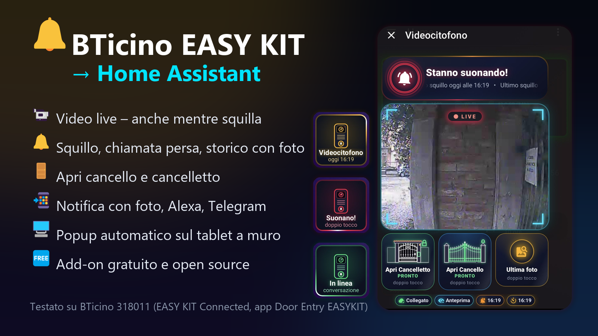
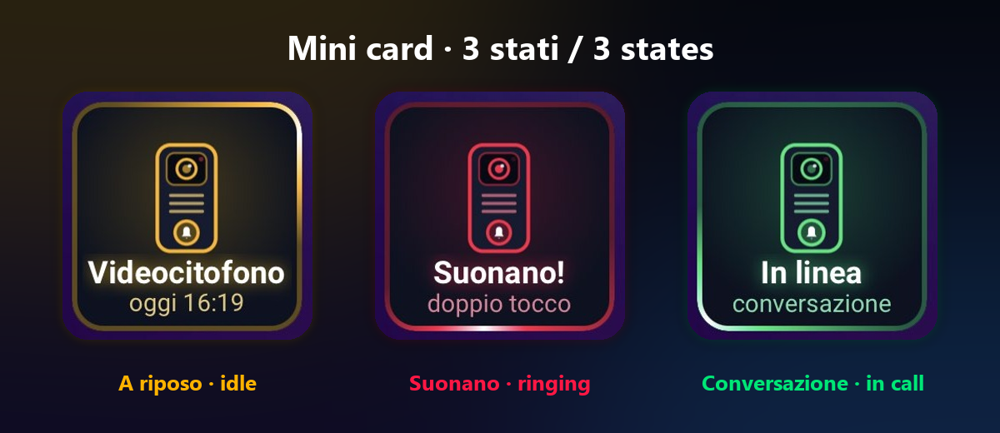
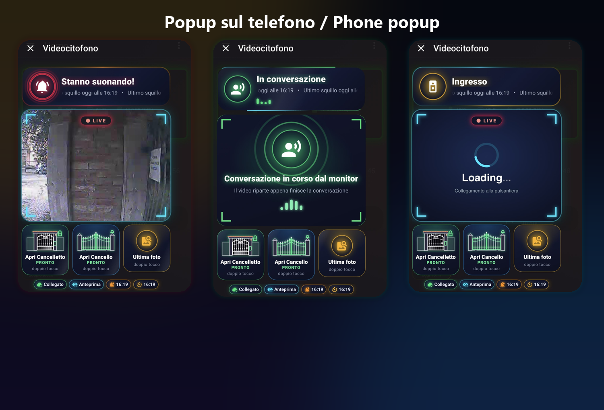
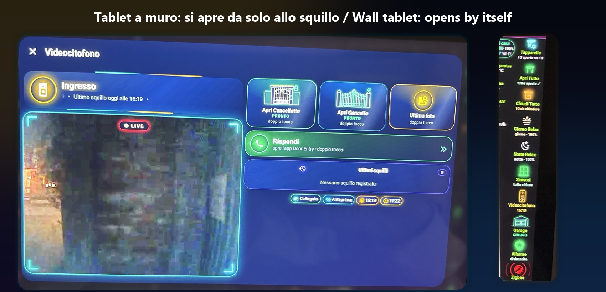
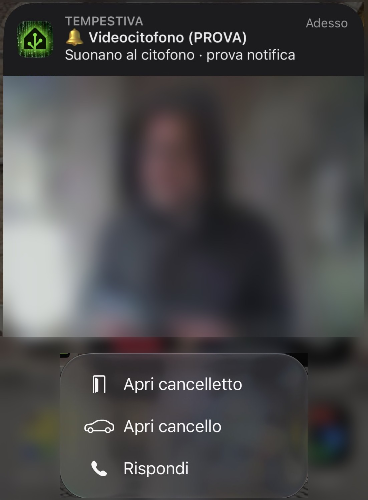
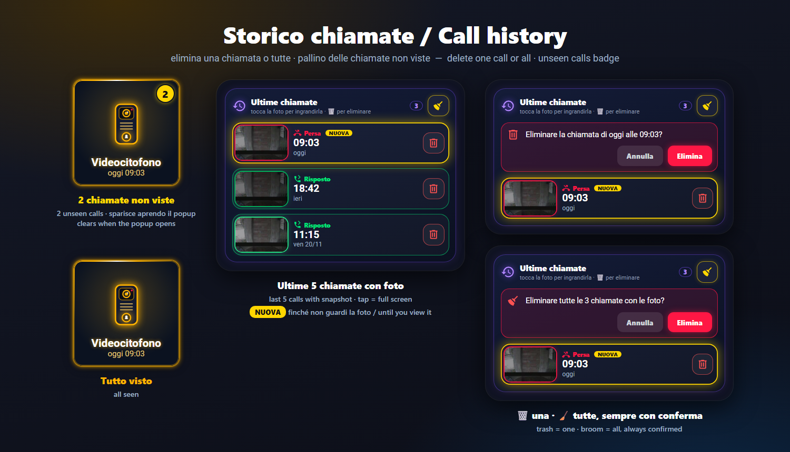

# BTicino EASY KIT → Home Assistant

**[English](#english) · [Italiano](#italiano)**

Unofficial Home Assistant add-on for the **BTicino EASY KIT Connected** door entry system (Wi-Fi monitor + 2-wire entrance panel, *Door Entry EASYKIT* app).
Add-on non ufficiale per Home Assistant per il videocitofono **BTicino EASY KIT Connected** (monitor Wi-Fi + pulsantiera 2 fili, app *Door Entry EASYKIT*).

---

## English

### Features
- 🔔 **Ring** detection in real time, **missed call** and **answered at home** events
- 📹 **Live video** of the entrance panel in Home Assistant – **also while it is ringing** (like the official app, the indoor monitor keeps ringing)
- 📸 **Snapshot** of who rings (for notifications) and **call history** (last 10, with photo and outcome)
- 🆕 **1.1.0:** delete one call 🗑️ or all of them 🧹 (with confirmation), **yellow badge** on the mini card with the number of **unseen calls**, tap a thumbnail to see the photo full screen
- 🚪 **Open** the locks of your kit (gate / door) from Home Assistant
- 🗣️ "**Call in progress**" status when someone answers from the monitor
- 📲 Ready-made examples: phone **notification with photo** and Open / Answer buttons, **Alexa**, **Telegram**, animated **mini card** and **popup**, **automatic popup on a wall tablet**
- 🔐 Guided login from the add-on page – your password is typed on the official BTicino page and never stored

| Mini card | Phone popup |
|---|---|
|  |  |

| Wall tablet | Notification |
|---|---|
|  |  |

**New in 1.1.0 – call history / Novità 1.1.0 – storico chiamate**

### Compatibility
| Kit | App | Status |
|---|---|---|
| **BTicino 318011** EASY KIT Connected 7" (white) | Door Entry EASYKIT | ✅ tested (monitor firmware 1.4.11) |
| BT-318012 / 318015, LG-369420 / 369430, BT-332851/52/55, LG-369425/35 | Door Entry EASYKIT | 🟡 should work (same app/cloud) – please report! |
| EASY KIT using the *Home + Security* app, Classe 100X / 300X | other apps | ❌ not supported |

Requirements: Home Assistant **OS or Supervised** (add-ons), **Mosquitto broker** add-on + MQTT integration, internet access (the kit talks through the BTicino cloud). Architectures: `aarch64` (tested, Raspberry Pi 5) and `amd64` (built, not tested yet).

### Installation
1. Click the blue button above, or go to **Settings → Apps → App store → ⋮ → Repositories** and add `https://github.com/Gapman1980/ha-bticino-easykit`.
   (Add it in the **App store**, not in the HACS / Marketplace.)
2. Install **BTicino EASY KIT** and start it.
3. Open its page (**Open web UI** or the *Videocitofono* item in the sidebar) and press **🔑 Log in to BTicino**. Log in with the same account as the *Door Entry EASYKIT* app (use *Sign in*, not *Sign up*).
4. Done: the add-on finds your door entry system, registers itself as a new device called "Home Assistant" (you will see it in the app's *Users* list) and creates the entities below and the camera `camera.videocitofono_video`.

Options: `language` (it/en entity names), and only if needed `login_host` (HA address on your LAN, if the login link shows a wrong one) and `plant_id` (if your account has more than one kit).

### Entities
| Entity | Description |
|---|---|
| `binary_sensor.videocitofono_squillo` | on while ringing |
| `event.videocitofono_chiamata` | `squillo` · `chiamata_persa` (nobody answered) · `risposta_altrove` (answered at home / app) |
| `binary_sensor.videocitofono_occupato` | call in progress from the monitor (video not available meanwhile) |
| `button.videocitofono_apri_<lock>` | one button per lock of your kit (e.g. `_apri_cancello`, `_apri_cancelletto`) |
| `camera.videocitofono_video` | live video (MJPEG) – the video call starts only while someone watches |
| `camera.videocitofono_foto` | last snapshot · `button.videocitofono_aggiorna_foto` takes a new one |
| `sensor.videocitofono_ultimo_squillo` / `_ultima_foto` | timestamps |
| `sensor.videocitofono_storico` | call history, last 10 (attribute `voci`: id, time, outcome, photo, `nuova`; attribute `nuove` = unseen calls) |
| MQTT `bticino_easykit/cmd/storico/…` | 1.1.0: `elimina` (payload = call id) deletes one call and its photo · `svuota` deletes all · `visto` marks all as seen (the popup does it when it opens) |
| `switch.videocitofono_anteprima` | video preview while ringing (on by default) |
| `binary_sensor.videocitofono_connesso` | connected to the BTicino service |

### Dashboard and automations
Requirements for the cards (HACS): **button-card**, **card-mod**, **browser_mod**.
- [`examples/mini_card_videocitofono.yaml`](examples/mini_card_videocitofono.yaml) – animated mini card (amber idle, red ringing, green in call) with the **yellow badge of unseen calls**. Double tap opens the popup.
- [`examples/popup_videocitofono.yaml`](examples/popup_videocitofono.yaml) – popup with live video, gate / door tiles, Answer, status and the **last 5 calls**: tap a thumbnail = full-screen photo (the yellow **NEW** frame goes away once you have seen it), 🗑️ deletes one call, 🧹 deletes all, always with a confirmation.
- [`examples/automazione_popup_tablet.yaml`](examples/automazione_popup_tablet.yaml) – the popup opens by itself on a wall tablet when someone rings (also wakes the iOS kiosk-mode screensaver).
- [`examples/automazioni_avvisi.yaml`](examples/automazioni_avvisi.yaml) – notification with photo + Open/Answer buttons (Face ID on iOS), Alexa, Telegram, missed call.

**Answer button (iOS):** two-way audio is not available in Home Assistant, so *Answer* opens the official app. Create once an iOS Shortcut named **`Apri Door Entry`** (action *Open app → Door Entry EASYKIT*).

### How it works / limitations
- Uses the BTicino cloud like the official app (SIP over TLS with a personal certificate). Internet is required.
- **No two-way audio** in Home Assistant (use the Answer button → official app).
- While someone talks from the indoor monitor the entrance panel is busy: the popup shows "call in progress" and the video comes back by itself afterwards.
- Opening the live video takes ~4 s (call to the panel through the cloud).
- Ring photos are saved in `/config/www/videocitofono/storico/` with random names (served under `/local/`, which does not require login: keep this in mind).
- Unofficial project, not affiliated with BTicino / Legrand. Use at your own risk.

### Credits
Built on the excellent MIT library **[BTicinoDoorEntry](https://github.com/s-dimaio/BTicinoDoorEntry)** by **Simone Di Maio** (also author of the Homey app). This add-on applies two small fixes at build time (`patch.js`: real H.264 profile in the RTSP description, needed by iPhone; `existing is not defined` on second login).

### Problems or another kit?
Open an [issue](https://github.com/Gapman1980/ha-bticino-easykit/issues/new/choose) (forms in Italian/English). Please include the add-on log (passwords and keys are never written there).

---

## Italiano

### Cosa fa
- 🔔 **Squillo** in tempo reale, eventi **chiamata persa** e **risposto in casa**
- 📹 **Video live** della pulsantiera in Home Assistant – **anche mentre squilla** (come l'app ufficiale: il monitor in casa continua a suonare)
- 📸 **Foto** di chi suona (per le notifiche) e **storico chiamate** (ultime 10, con foto ed esito)
- 🆕 **1.1.0:** elimina una chiamata 🗑️ o tutte 🧹 (con conferma), **pallino giallo** sulla mini card con il numero di **chiamate non viste**, tocchi la miniatura e vedi la foto a schermo intero
- 🚪 **Apri** le serrature del kit (cancello / cancelletto) da Home Assistant
- 🗣️ Stato "**Conversazione in corso**" quando si risponde dal monitor
- 📲 Esempi pronti: **notifica con foto** e pulsanti Apri / Rispondi, **Alexa**, **Telegram**, **mini card** e **popup** animati, **popup automatico sul tablet a muro**
- 🔐 Login guidato dalla pagina dell'add-on – la password la scrivi sulla pagina ufficiale BTicino e non viene salvata

### Compatibilità
| Kit | App | Stato |
|---|---|---|
| **BTicino 318011** EASY KIT Connected 7" bianco | Door Entry EASYKIT | ✅ provato (firmware monitor 1.4.11) |
| BT-318012 / 318015, LG-369420 / 369430, BT-332851/52/55, LG-369425/35 | Door Entry EASYKIT | 🟡 dovrebbe funzionare (stessa app/cloud) – fatecelo sapere! |
| EASY KIT con app *Home + Security*, Classe 100X / 300X | altre app | ❌ non supportati |

Serve: Home Assistant **OS o Supervised**, add-on **Mosquitto broker** + integrazione MQTT, connessione internet (il kit passa dal cloud BTicino). Architetture: `aarch64` (provato, Raspberry Pi 5) e `amd64` (compilato, non ancora provato).

### Installazione
1. Premi il pulsante blu in alto, oppure **Impostazioni → App → Store delle app → ⋮ → Repository** e aggiungi `https://github.com/Gapman1980/ha-bticino-easykit`.
   (Va aggiunto nello **Store delle app**, non in HACS / Marketplace.)
2. Installa **BTicino EASY KIT** e avvialo.
3. Apri la sua pagina (**Apri interfaccia web** o la voce *Videocitofono* nel menu laterale) e premi **🔑 Accedi a BTicino**. Entra con lo stesso account dell'app *Door Entry EASYKIT* (usa *Accedi*, non *Iscriviti*).
4. Fatto: l'add-on trova il videocitofono, si registra come nuovo dispositivo "Home Assistant" (lo vedrai fra gli *Utenti* dell'app) e crea le entità e la telecamera `camera.videocitofono_video`.

Opzioni: `language` (nomi entità it/en) e, solo se serve, `login_host` (indirizzo di HA in casa, se il link di login ne mostra uno sbagliato) e `plant_id` (se nell'account ci sono più kit).

### Entità
Vedi la tabella *Entities* sopra: i nomi sono gli stessi (`videocitofono_squillo`, `videocitofono_chiamata`, `videocitofono_apri_<serratura>`, `videocitofono_video`, ...).

**Storico (1.1.0):** `sensor.videocitofono_storico` ha l'attributo `nuove` (chiamate non viste) e ogni voce ha un `id`. Comandi MQTT: `bticino_easykit/cmd/storico/elimina` (payload = id) cancella una chiamata con la sua foto, `…/svuota` le cancella tutte, `…/visto` le segna come viste (lo fa il popup quando si apre).

### Dashboard e automazioni
Per le card servono (HACS): **button-card**, **card-mod**, **browser_mod**. Esempi nella cartella [`examples/`](examples/):
- **mini card** animata (ambra a riposo, rossa quando suonano, verde in conversazione) con il **pallino giallo delle chiamate non viste**, doppio tocco = popup;
- **popup** con video live, piastrelle cancello/cancelletto animate, Rispondi, stato e **ultime 5 chiamate**: tocco sulla miniatura = foto a schermo intero (il riquadro giallo **NUOVA** sparisce dopo averla vista), 🗑️ elimina una chiamata, 🧹 tutte, sempre con conferma;
- **popup automatico sul tablet a muro** allo squillo (spegne anche il salvaschermo della modalità kiosk iOS);
- **notifica con foto** e pulsanti Apri/Rispondi (Face ID su iOS), **Alexa**, **Telegram**, **chiamata persa**.

**Pulsante Rispondi (iOS):** l'audio a due vie in Home Assistant non c'è, quindi *Rispondi* apre l'app ufficiale. Crea una volta un Comando Rapido chiamato **`Apri Door Entry`** (azione *Apri app → Door Entry EASYKIT*).

### Come funziona / limiti
- Usa il cloud BTicino come l'app ufficiale (SIP su TLS con certificato personale). Serve internet.
- **Niente audio a due vie** in Home Assistant (usa Rispondi → app ufficiale).
- Mentre si parla dal monitor la pulsantiera è occupata: il popup mostra "conversazione in corso" e il video torna da solo dopo.
- Il video live parte in ~4 s (chiamata alla pulsantiera tramite cloud).
- Le foto dello storico stanno in `/config/www/videocitofono/storico/` con nomi casuali (servite sotto `/local/`, che non richiede login: tienilo presente).
- Progetto non ufficiale, non affiliato a BTicino / Legrand. Uso a proprio rischio.

### Ringraziamenti
Basato sulla libreria MIT **[BTicinoDoorEntry](https://github.com/s-dimaio/BTicinoDoorEntry)** di **Simone Di Maio** (autore anche dell'app per Homey). L'add-on applica due piccole correzioni in fase di build (`patch.js`).

### Problemi o un altro kit?
Apri una [issue](https://github.com/Gapman1980/ha-bticino-easykit/issues/new/choose) (moduli in italiano/inglese) e allega il registro dell'add-on (password e chiavi non vi vengono mai scritte).

---
MIT License · © 2026 Gapman1980
